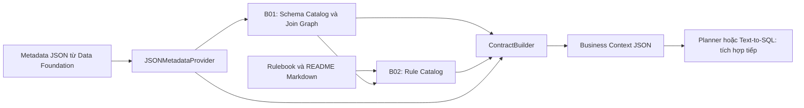

# DataMate B01/B02 — Những gì đã làm, input và output

**Cập nhật:** 04/11/2026. **Contract hiện tại:** `1.0`.

Tài liệu này mô tả implementation đang có trong repository để team review và tích hợp. B01/B02 đã có code, adapter metadata JSON, service điều phối, CLI và tests. Toàn bộ Master Plan chưa hoàn thành: producer Data Foundation production và pipeline Text-to-SQL end-to-end chưa được nối vào các module này.

## 1. Hệ thống hiện làm được gì?

Nhận schema/profile do Data Foundation cung cấp cùng rulebook/README, xây metadata về bảng, khóa, quan hệ và quy tắc nghiệp vụ, rồi xuất **Business Context JSON**. Downstream có thể dùng metadata này để chọn bảng, lập kế hoạch join và lấy luật phù hợp.

| Thành phần | Phần đã triển khai |
|---|---|
| Metadata adapter | Nhận metadata JSON version `1.0`; kiểm tra business scope, cấu trúc, kiểu dữ liệu metadata và tham chiếu quan hệ |
| B01 — Schema Catalog | Catalog bảng/cột/type/provenance; kiểm tra candidate key đơn và khóa ghép; giữ grain khai báo hoặc suy ra grain cấu trúc có evidence |
| B01 — Join Graph | Candidate joins từ profile; xác minh quan hệ khai báo; kiểm tra tuple khóa ghép, cardinality, coverage và cảnh báo fanout |
| Join consumer API | Tìm đường join đã xác minh; biên dịch điều kiện equijoin đầy đủ mọi thành phần khóa |
| B02 — Rule Catalog | Đọc Markdown rulebook/README; lưu nội dung, ID, nguồn, scope, industry, topic và mức ưu tiên |
| B02 — Rule Resolver | Lọc theo business/ngành/câu hỏi rồi chọn mức ưu tiên; chặn topic có rule thắng invalid hoặc mâu thuẫn |
| B02 — Rule Compiler | Validate DSL có cấu trúc; sinh SQL fragment và bound parameters; từ chối thực thi rule chưa validated |
| B02 — Formula binding | Binding có điều kiện cho ba công thức đã đối chiếu với rulebook: `revenue`, `gross_profit`, `sold_qty_base` |
| Contract và service | Ghép B01/B02 thành Business Context, giữ metadata chưa có ở trạng thái `null`, loại dòng profile nội bộ khỏi JSON đầu ra |
| CLI và ví dụ | Chạy bằng `python3 -m datamate`; có ví dụ synthetic độc lập với dataset cuộc thi |

## 2. Luồng input → xử lý → output



`BusinessContextService.prepare()` chạy luồng chuẩn bị context trên. Các API `RuleResolver`, `RuleTemplateBinder`, `compile_rule()` và join consumer được gọi riêng khi downstream cần. Service/CLI hiện chưa tự chọn ngành, tạo question override hay binding công thức.

## 3. Input của luồng chính

### 3.1. Metadata JSON từ Data Foundation

Đây là **metadata đầu vào của producer**, khác với Business Context JSON đầu ra.

| Trường | Bắt buộc | Ý nghĩa |
|---|---|---|
| `metadata_version` | Có | Hiện nhận chuỗi `"1.0"` |
| `business_id` | Có | Phải khớp business được yêu cầu |
| `tables` | Có | Mảng metadata của các bảng đã được producer khám phá/chuẩn hóa |
| `relationships` | Không | Quan hệ khai báo, mặc định `[]`; không nhận trường `status` từ producer |
| `data_profiling` | Không | Object profiling do Data Foundation cung cấp, hoặc `null` |
| `business_metadata` | Không | Object metadata nghiệp vụ do module sở hữu cung cấp, hoặc `null` |
| `answerability_constraints` | Không | Object ràng buộc coverage/khả năng trả lời, hoặc `null` |

Mỗi phần tử `tables` nhận:

| Trường | Ý nghĩa |
|---|---|
| `name`, `columns` | Tên bảng và mảng cột; mỗi cột cần `name` |
| `columns[].data_type` | Kiểu vật lý do producer cung cấp; mặc định `unknown`, adapter không tự cast dữ liệu |
| `columns[].nullable`, `null_ratio`, `cardinality`, `provenance` | Metadata tùy chọn; chưa biết thì để thiếu hoặc `null` |
| `row_count` | Số dòng toàn bảng nếu có |
| `grain`, `grain_evidence`, `provenance` | Ý nghĩa mỗi dòng và nguồn bằng chứng nếu đã biết |
| `primary_key_candidates` | Các candidate key đơn cột đã được upstream đề xuất |
| `composite_key_candidates` | Mảng các nhóm cột khóa ghép đã được đề xuất |
| `profile_rows` | Các dòng do producer cung cấp cho kiểm tra khóa/join; có thể là sample |
| `profile_is_complete` | Khai báo profile đầy đủ; nếu có rows và row_count thì số lượng phải khớp |

Không đánh dấu sample là profile đầy đủ. Thiếu bảng/cột trong metadata chưa đủ để kết luận câu hỏi không trả lời được. B01/B02 không đọc lại dữ liệu thô để thay thế công việc normalization của Data Foundation.

### 3.2. Ví dụ input tối thiểu chạy được

Ví dụ synthetic sau chỉ có một bảng và không truyền tài liệu nghiệp vụ:

```json
{
  "metadata_version": "1.0",
  "business_id": "demo_shop",
  "tables": [
    {
      "name": "orders",
      "columns": [{"name": "id", "data_type": "INTEGER"}],
      "row_count": 2,
      "grain": "one order",
      "provenance": "synthetic fixture",
      "profile_rows": [{"id": 1}, {"id": 2}],
      "profile_is_complete": true
    }
  ]
}
```

Một ví dụ đầy đủ hơn, có hai bảng và quan hệ khai báo, nằm tại [examples/foundation_metadata.json](../examples/foundation_metadata.json).

### 3.3. Rulebook và README

Input thứ hai là danh sách đường dẫn Markdown, ví dụ rulebook của split đang chạy và README đúng business. CLI dùng `--document` lặp lại cho từng file.

- Không truyền tài liệu: rule catalog rỗng.
- Truyền file không tồn tại: catalog ghi warning; hệ thống không tự tạo nội dung thay thế.
- README của business khác được nhận diện qua thư mục `biz_<số>`: bỏ qua và ghi warning.
- Quy tắc được đọc chủ yếu thành record `descriptive`; việc đọc thành công chưa có nghĩa công thức đã được hiểu hoặc biên dịch.

## 4. Output của luồng chính: Business Context JSON

Output có cấu trúc:

| Trường | Nguồn và nội dung |
|---|---|
| `contract_version` | Version của Business Context; hiện `"1.0"` |
| `business_id` | Business sở hữu context |
| `schema_catalog.tables` | Bảng/cột, metadata và grain evidence |
| `schema_catalog.key_candidates` | Candidate keys kèm status/confidence/evidence |
| `schema_catalog.join_graph` | Các cạnh join kèm khóa, cardinality, status, evidence và fanout warning |
| `schema_catalog.warnings` | Vấn đề chưa xác minh hoặc metadata chưa đủ |
| `rule_catalog` | Rules, warnings và business scope |
| `data_profiling`, `business_metadata`, `answerability_constraints` | Chuyển tiếp từ producer; chưa có thì `null` |

`profile_rows` được dùng nội bộ và bị loại khi gọi `BusinessContext.to_dict()`. Những thống kê khác không được tự tạo để lấp chỗ trống.

### Output thực tế cho input tối thiểu ở mục 3.2

JSON sau lấy từ các module hiện tại, với danh sách tài liệu rỗng. Cách xuống dòng được rút gọn để dễ đọc; không lược bỏ trường:

```json
{
  "contract_version": "1.0",
  "business_id": "demo_shop",
  "schema_catalog": {
    "tables": [
      {
        "name": "orders",
        "columns": [
          {
            "name": "id",
            "data_type": "INTEGER",
            "nullable": null,
            "null_ratio": null,
            "cardinality": null,
            "provenance": null
          }
        ],
        "row_count": 2,
        "grain": "one order",
        "primary_key_candidates": [],
        "provenance": "synthetic fixture",
        "profile_is_complete": true,
        "composite_key_candidates": [],
        "grain_evidence": ["upstream grain declaration; source=synthetic fixture"]
      }
    ],
    "key_candidates": [
      {
        "table": "orders",
        "columns": ["id"],
        "key_type": "primary",
        "status": "candidate",
        "confidence": 1.0,
        "evidence": ["complete profile verifies non-null uniqueness of ('id',)"]
      }
    ],
    "join_graph": [],
    "warnings": []
  },
  "rule_catalog": {"rules": [], "warnings": [], "business_id": "demo_shop"},
  "data_profiling": null,
  "business_metadata": null,
  "answerability_constraints": null
}
```

`confidence` là điểm heuristic/evidence do module gán, chưa phải xác suất đúng đã calibration. `status: candidate` của khóa không có nghĩa đã tạo constraint PRIMARY KEY trong database.

## 5. Input/output của B01

| API | Input | Output |
|---|---|---|
| `SchemaCatalogBuilder.build()` | Danh sách `TableMetadata`, danh sách `JoinEdge` khai báo tùy chọn | `SchemaCatalog` |
| `JoinGraphNavigator.find_path()` | Catalog, tên bảng đầu và bảng đích | Tuple cạnh `validated`; `None` nếu chưa có đường đã xác minh |
| `JoinPredicateCompiler.compile()` | Cạnh `validated` thuộc catalog và catalog đó | Chuỗi điều kiện equijoin SQL |

Các khả năng đã có:

- Kiểm tra uniqueness và NULL cho khóa đơn/khóa ghép; sample chỉ cung cấp bằng chứng chưa đầy đủ.
- Tự tìm khóa đơn và tối đa 256 cặp cột mỗi bảng; khóa rộng hơn có thể được upstream khai báo.
- Giữ grain được upstream mô tả. Khi chỉ có khóa rõ ràng, có thể suy ra grain cấu trúc như `row keyed by (order_id, line_no)`, chưa suy ra ý nghĩa nghiệp vụ.
- Join từ trùng tên/overlap giá trị luôn là giả thuyết `uncertain`.
- Quan hệ khai báo có source evidence và profile đầy đủ hai đầu mới được kiểm tra structural coverage/cardinality để đánh dấu `validated`, `invalid` hoặc `uncertain`.
- Một-nhiều/nhiều-một vẫn cảnh báo fanout dù join đã validated. Planner phải tổng hợp đúng grain trước khi cộng metric.

### Biểu diễn join khóa ghép

Ví dụ input khai báo trong `relationships`:

```json
{
  "left_table": "allocations",
  "left_column": "order_ref",
  "right_table": "lines",
  "right_column": "order_id",
  "additional_key_pairs": [["line_ref", "line_no"]],
  "cardinality": "many_to_one",
  "evidence": ["README: allocation tham chiếu mã đơn và số thứ tự dòng"]
}
```

Khi cạnh này đã validated và hai bảng/cột tồn tại trong catalog, output của join predicate compiler là:

```sql
"allocations"."order_ref" = "lines"."order_id" AND "allocations"."line_ref" = "lines"."line_no"
```

Consumer phải dùng cả cặp đầu và `additional_key_pairs`. Property Python `edge.key_pairs` trả toàn bộ cặp khóa; property này không phải trường JSON riêng. Không có đường join validated chỉ có nghĩa metadata chưa đủ, không đồng nghĩa `unanswerable`.

## 6. Input/output của B02

### 6.1. Đọc tài liệu → Rule Catalog

`BusinessRuleCompiler.ingest_documents(paths, business_id, schema)` nhận Markdown và schema tùy chọn, trả `RuleCatalog`.

Mỗi `BusinessRule` có các trường chính:

| Nhóm | Trường |
|---|---|
| Nội dung và định danh | `rule_id`, `text`, `topic` |
| Nguồn và phạm vi | `source`, `scope`, `precedence`, `industry`, `question_id` |
| Liên kết schema và công thức | `required_fields`, `expression` |
| Trạng thái kiểm tra | `status`, `validation_messages` |
| Điều kiện binding | `requirements`, `binding_evidence` |

ID được tạo deterministic từ nguồn/phạm vi/nội dung. Source lưu vị trí file và dòng. Industry lấy từ heading của rulebook; topic của hàng Markdown lấy từ nhãn đầu hàng. Rule văn bản thông thường được giữ ở trạng thái `descriptive`; field được nhắc đến trong văn bản chưa được xem là một công thức đã validate.

### 6.2. Chọn rule theo request

Input của `RuleResolver.resolve()`:

- `catalog`: Rule Catalog của business.
- `business_id`: bắt buộc.
- `industry`: tùy chọn; nếu thiếu thì rule theo ngành không được chọn.
- `question_id`: tùy chọn; question override chỉ áp dụng đúng ID.

Output là `ResolvedRules` với `rules`, `blocked_topics`, `warnings`.

Precedence đang áp dụng: `question_override (400) > business (300) > industry (200) > split_default (100)`. Chỉ các rule có cùng topic mới cạnh tranh. Khác cách diễn đạt không được tự xem là cùng một metric. Khi rule thắng invalid hoặc các rule cao nhất mâu thuẫn, topic bị chặn; không âm thầm rơi xuống luật thấp hơn.

### 6.3. DSL có cấu trúc → SQL fragment và parameters

Input ví dụ cho `compile_expression()`:

```json
{
  "op": "and",
  "items": [
    {"op": "eq", "field": "status", "value": "Hoàn thành"},
    {"op": "gte", "field": "amount", "value": 100}
  ]
}
```

Với schema có hai cột trên và không có tên cột mơ hồ, output Python tương đương:

```text
sql_fragment = ("status" = ? AND "amount" >= ?)
parameters = ("Hoàn thành", 100)
```

Các giá trị nằm trong `parameters`, không ghép trực tiếp vào SQL. API trả fragment, chưa tạo full query. Nếu nhiều bảng có cột cùng tên thì dùng `table.column`.

DSL đã hỗ trợ so sánh, `in`, kiểm tra NULL, logic, `field`, `literal`, cộng/trừ/nhân/chia, `sum`, `count_distinct`, `count_rows`. Không nhận raw SQL hay nested aggregates; giới hạn độ sâu 32. Chia cho 0 trả NULL; SUM trên tập rỗng giữ NULL; việc làm tròn theo format cuộc thi thuộc downstream.

`compile_expression()` kiểm tra cú pháp DSL và field. Để thực thi một business rule đã lưu trong catalog, dùng `compile_rule()`: API này còn yêu cầu `status == validated` và có expression.

### 6.4. Binding ba công thức đã đối chiếu rulebook

`RuleTemplateBinder.bind()` nhận rule đã được resolver chọn, tên template, ánh xạ role → field, schema và evidence cho các điều kiện nghiệp vụ.

| Template | Role bắt buộc | Công thức được phát ra |
|---|---|---|
| `revenue` | `line_amount` | Tổng thành tiền dòng sau giảm giá dòng |
| `gross_profit` | `line_amount`, `quantity`, `unit_cost` | Tổng `line_amount - quantity × unit_cost` |
| `sold_qty_base` | `base_quantity` | Tổng lượng bán quy về đơn vị cơ bản |

Binder đối chiếu nguyên đoạn luật đã review, có chuẩn hóa NFC/khoảng trắng. Chỉ trùng tên topic không đủ để áp template. Đoạn luật thay đổi ở split/câu hỏi khác phải được review trước.

Output là một `BusinessRule` đã gắn `expression`, `required_fields`, `requirements`, `binding_evidence` và status. Thiếu evidence thì output là `invalid`, không được `compile_rule()` thực thi.

Ví dụ điều kiện cần evidence: đã bỏ đơn hủy/trả cả đơn kể cả trả một phần, lọc theo ngày đặt đúng kỳ, không nhân dòng, dùng thành tiền đúng định nghĩa, giá vốn tại thời điểm bán và cùng đơn vị bán. `binder.requirements(template)` trả danh sách đầy đủ. Evidence là assertion có trace từ upstream; binder không tự kiểm chứng rằng SQL upstream đã thực hiện đúng các điều kiện đó.

## 7. Chạy và sử dụng trong Python

### CLI

Từ root repository:

```bash
PYTHONPATH=src python3 -m datamate \
  --metadata examples/foundation_metadata.json \
  --business-id example_shop \
  --document examples/README.md
```

CLI đọc file và ghi JSON ra stdout. Metadata lỗi được ghi ra stderr, exit code `1`; lỗi tham số CLI dùng cơ chế argparse. CLI không tự ghi output/cache vào repository. Metadata synthetic trong ví dụ là dữ liệu demo.

### Service trong Python

```python
from datamate.context_service import BusinessContextService
from datamate.contracts import ContractBuilder
from datamate.metadata_adapter import JSONMetadataProvider
from datamate.rule_compiler import BusinessRuleCompiler
from datamate.schema_catalog import SchemaCatalogBuilder

service = BusinessContextService(
    provider=JSONMetadataProvider("examples/foundation_metadata.json"),
    schema_builder=SchemaCatalogBuilder(),
    rule_compiler=BusinessRuleCompiler(),
    contract_builder=ContractBuilder(),
)
context = service.prepare("example_shop", ["examples/README.md"])
payload = context.to_dict()
```

Team có thể kế thừa `BaseMetadataProvider.load(business_id)` để trả `FoundationMetadata` trực tiếp từ Data Foundation mà không phải đổi logic B01/B02. `to_dict()` trả cấu trúc Python; CLI dùng `json.dumps()` để chuyển các tuple thành JSON arrays.

## 8. Kết nối với Text-to-SQL

Theo thiết kế trong [input_output_text2sql.md](../khoi_docs/input_output_text2sql.md), downstream nhận Data Contract, câu hỏi tiếng Việt và `as_of_date`. Business Context hiện tại là phần metadata để tích hợp vào đầu vào đó; cần thống nhất mapping với owner Text-to-SQL.

**Output hiện tại của CLI là Business Context, chưa phải SQL trả lời câu hỏi.** Các JSON sau thuộc tầng khác:

- Response Text-to-SQL dự kiến: `status`, `answer_type`, `sql`, `tables_used`, `assumptions`, `reason`.
- Record nộp bài: `id`, `type`, `answer` và các trường tùy type.

Question parsing, giải thời gian theo `as_of_date`, sinh full query, thực thi query, quyết định unanswerable/abstain và định dạng đáp án chưa được service này triển khai. `question_id` trong resolver chỉ dùng để giới hạn override, không có nghĩa đã có question parser.

## 9. File đã có và kết quả kiểm chứng

| File | Trách nhiệm |
|---|---|
| [contracts.py](../src/datamate/contracts.py) | Các DTO và ContractBuilder |
| [metadata_adapter.py](../src/datamate/metadata_adapter.py) | FoundationMetadata, provider ABC và adapter JSON |
| [schema_catalog.py](../src/datamate/schema_catalog.py) | Khóa, grain và kiểm tra quan hệ B01 |
| [join_graph.py](../src/datamate/join_graph.py) | Đường join validated và join predicates |
| [rule_compiler.py](../src/datamate/rule_compiler.py) | Ingestion, structured rules, validation và SQL fragments |
| [rule_resolver.py](../src/datamate/rule_resolver.py) | Scope, precedence và blocked topics |
| [rule_templates.py](../src/datamate/rule_templates.py) | Binding công thức đã review |
| [context_service.py](../src/datamate/context_service.py) | Điều phối qua dependency injection |
| [__main__.py](../src/datamate/__main__.py) | CLI |
| [tests/](../tests/) | Unit tests, SQL execution tests và real-data smoke tests |
| [DATA_CONTRACT.md](DATA_CONTRACT.md) | Chi tiết contract bằng tiếng Anh |

Kết quả kiểm chứng gần nhất của phần triển khai trước khi viết tài liệu này:

- **45 tests pass** khi bật các test dataset.
- Smoke test metadata từ CSV của `biz_111`, `biz_127` và SQLite của `biz_123`: B01 → B02 → JSON Contract.
- Các reader CSV/SQLite nằm trong tests; SQLite dùng read-only. Chúng không phải loader production.
- Binding đối chiếu rulebook thật được kiểm thử số học trên fixture SQLite trong bộ nhớ; không phải điểm PA trên câu hỏi train.
- Ingestion/resolution tài liệu đã được kiểm tra trên 30 business.
- Ruff lint toàn repo và format các file triển khai đã pass. Không có dependency runtime mới trong `pyproject.toml`; tests dùng standard library, Ruff được chạy qua `uvx`.

Lệnh tái lập:

```bash
# Unit tests; các test dataset được skip nếu không bật biến bên dưới.
PYTHONPATH=src python3 -m unittest discover -s tests -v

# Có dataset train, chạy cả smoke tests.
DATAMATE_TRAIN_DIR=data/train PYTHONPATH=src python3 -m unittest discover -s tests -v
```

## 10. Những việc còn lại trong Master Plan

| Phần còn lại | Tình trạng/phạm vi cần nối tiếp |
|---|---|
| Producer Data Foundation production | Cần cung cấp metadata đúng schema, normalization và evidence; adapter JSON/ABC đã sẵn sàng |
| Ingestion XLSX và messy data | Chưa có reader/normalizer production trong phạm vi implementation này |
| Suy luận ngữ nghĩa grain | Mới giữ grain upstream hoặc suy ra identity theo khóa; chưa tự hiểu toàn bộ README |
| Business Rule Compiler tổng quát | Phần lớn rules còn descriptive; chưa tự trích và biên dịch mọi công thức từ văn bản |
| Luật công nợ/thời gian/quy đổi đầy đủ | Chưa có thư viện executable đầy đủ cho các nhóm nghiệp vụ này |
| Metadata Registry/Capabilities | Chuyển tiếp dữ liệu có sẵn; chưa tự xây metric registry hoặc coverage matrix hoàn chỉnh |
| Text-to-SQL và execution | Chưa có full query generation/executor được tích hợp vào service |
| Cache/version lifecycle | Chưa có cache theo file hash, parser version và rule version |
| Evaluation đầy đủ | Chưa có benchmark PA, full-train regression về đáp án hay benchmark runtime/bộ nhớ cho toàn bộ inference |

Điểm bàn giao hiện tại là một semantic layer chạy được qua metadata provider, có input/output tường minh và kiểm chứng structural/numeric. Để trả lời câu hỏi cuộc thi, team cần nối producer dữ liệu, planner/executor và output gate theo kiến trúc chung.
