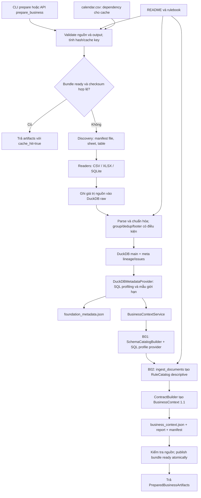
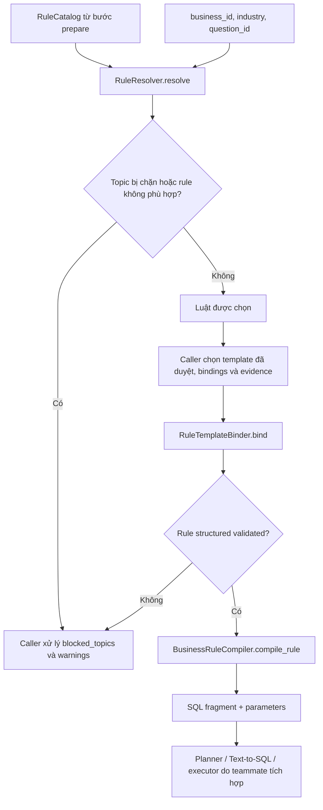

# Report source code và flow B01/B02

**Nhánh:** `feature/datamate-b01-b02` · **Mốc source được mô tả:** `bd1d242` · **Ngày:** 05/11/2026.

Tài liệu dành cho teammate cần hiểu mỗi file làm gì, đọc code từ đâu và các module trao đổi input/output như thế nào. Nội dung đối chiếu với source hiện có; các chức năng cần caller gọi thêm được tách khỏi flow tự chạy của CLI.

## 1. Hiểu hệ thống trong một phút

**B01 chuẩn bị dữ liệu và mô tả cấu trúc dữ liệu.** Input là thư mục chứa CSV/XLSX/SQLite và tài liệu liên quan. Output là database DuckDB, metadata bảng/cột, thống kê, candidate keys và join graph.

**B02 quản lý ý nghĩa nghiệp vụ.** Input là README/rulebook và schema B01. Output ban đầu là danh sách luật có nguồn, phạm vi và mức ưu tiên. B02 còn cung cấp API chọn luật theo ngữ cảnh, gắn công thức đã duyệt vào cột thực tế và biên dịch biểu thức có cấu trúc thành SQL fragment có tham số.

**`BusinessContextService` ghép hai phần thành Business Context.** Teammate Text-to-SQL dùng context để hiểu bảng/cột/luật; executor dùng database để đọc dữ liệu. Nhánh hiện tại chưa có LLM sinh câu SQL hoàn chỉnh, query API hoặc executor trả lời câu hỏi.

“Data Foundation” là tên tầng khám phá, đọc, chuẩn hóa và profiling dữ liệu trong kiến trúc dự án. Tầng này hiện nằm trong B01, tại package `ingestion`; đây không phải tên ban tổ chức hay một bên phải chuẩn bị JSON thủ công trước.

## 2. Bản đồ source

```text
src/datamate/
├── __init__.py                 # Export object contract dùng chung
├── __main__.py                 # Entrypoint CLI
├── contracts.py                # Định nghĩa cấu trúc dữ liệu và validate context
├── metadata_adapter.py         # Interface provider và adapter metadata JSON
├── context_service.py          # Ghép provider → B01 → B02 → context
├── schema_catalog.py           # B01: catalog, keys, grain, join graph
├── join_graph.py               # B01: tìm đường join và biên dịch predicate
├── rule_compiler.py            # B02: đọc tài liệu, validate/compile DSL
├── rule_resolver.py            # B02: chọn luật theo scope và precedence
├── rule_templates.py           # B02: binding công thức đã duyệt
└── ingestion/
    ├── __init__.py             # Public API chuẩn bị business
    ├── models.py               # Config, source DTO, artifact DTO, error
    ├── readers.py              # Đọc CSV/XLSX/SQLite và nhận diện bảng
    ├── normalization.py        # Nhận diện role và parse giá trị
    ├── preparation.py          # Điều phối build, cache, materialize, publish
    └── profiling.py            # Provider metadata và kiểm chứng bằng SQL
```

Hai cách chạy chính:

| Cách chạy | Input | Công việc |
|---|---|---|
| `python -m datamate prepare ...` | File dataset của business | Tạo DuckDB và bundle JSON; context dùng contract 1.1 |
| `python -m datamate --metadata ...` | Metadata JSON có sẵn | Xây B01/B02/context từ metadata; ví dụ legacy 1.0 vẫn chạy; không import dataset hay tạo database |

## 3. Ý nghĩa từng file trong `src/datamate`

### 3.1. `__init__.py` — cửa vào package

File: [src/datamate/__init__.py](../src/datamate/__init__.py).

Export `BusinessContext` và `ContractBuilder` để module khác có thể import từ `datamate`. File này không chạy ingestion hoặc truy vấn dữ liệu khi được dùng như một API contract.

### 3.2. `__main__.py` — nhận lệnh từ terminal

File: [src/datamate/__main__.py](../src/datamate/__main__.py).

- `main()` nhận diện hai mode. Nếu đối số đầu là `prepare`, chuyển sang `prepare_main()`; nếu không, dùng luồng metadata JSON.
- `prepare_main()` đọc `--business-dir`, `--output-dir`, `--rulebook`, `--calendar`, `--config`, rồi gọi `prepare_business()`.
- Mode dataset in JSON mô tả artifacts ra stdout. Mode metadata in Business Context JSON ra stdout. Lỗi được báo qua stderr với exit code khác 0.

**Input:** CLI arguments. **Output:** JSON trên terminal và, với mode prepare, các artifacts được tạo trên đĩa.

### 3.3. `contracts.py` — ngôn ngữ chung giữa các module

File: [src/datamate/contracts.py](../src/datamate/contracts.py).

Định nghĩa các dataclass dùng để trao đổi dữ liệu:

| Object | Ý nghĩa |
|---|---|
| `ColumnMetadata` | Tên cột, kiểu dữ liệu, NULL, cardinality, provenance |
| `TableMetadata` | Bảng/cột, số dòng, grain, candidate keys và profile nội bộ |
| `KeyCandidate` | Nhóm cột có thể làm khóa, trạng thái kiểm chứng và evidence |
| `JoinEdge` | Hai bảng/cột liên hệ, các cặp khóa ghép, cardinality, status, fanout warning |
| `SchemaCatalog` | Kết quả B01: bảng, keys, joins và warnings |
| `BusinessRule` | Một luật: nội dung, nguồn, scope, topic, status, expression và evidence |
| `RuleCatalog` | Danh sách luật B02 trong phạm vi business |
| `BusinessContext` | Object đầu ra ghép schema, rules, profiling, business metadata và database handle |

`ContractBuilder.build()` kiểm tra business scope, trùng tên, tham chiếu bảng/cột, key pairs và các field được luật structured sử dụng. Khi có database handle, builder xuất contract `1.1`; luồng legacy không có handle tiếp tục dùng `1.0`.

`BusinessContext.to_dict()` chuyển dataclass sang object có thể ghi JSON, bỏ `profile_rows` nội bộ khỏi schema catalog. Các mẫu giới hạn trong `data_profiling` vẫn được giữ để downstream tham khảo.

**Input:** các object B01/B02 và metadata bổ sung. **Output:** `BusinessContext` đã kiểm tra tính nhất quán.

### 3.4. `metadata_adapter.py` — thống nhất nguồn metadata

File: [src/datamate/metadata_adapter.py](../src/datamate/metadata_adapter.py).

- `FoundationMetadata`: object trung gian chứa tables, relationships, profiling, business metadata và handle nếu có.
- `BaseMetadataProvider.load(business_id)`: interface để service nhận metadata mà không phụ thuộc cách đọc nguồn.
- `JSONMetadataProvider`: đọc envelope JSON 1.0/1.1, kiểm tra kiểu dữ liệu, business ID, trường không hỗ trợ và tham chiếu quan hệ.

Adapter JSON không tự đọc CSV/Excel/SQLite và không dựng database. Provider DuckDB ở `ingestion/profiling.py` triển khai cùng interface để dùng chung `BusinessContextService`.

**Input:** metadata JSON. **Output:** `FoundationMetadata`.

### 3.5. `context_service.py` — điều phối phần semantic

File: [src/datamate/context_service.py](../src/datamate/context_service.py).

`BusinessContextService.prepare()` thực hiện đúng thứ tự:

```text
provider.load(business_id)
  → SchemaCatalogBuilder.build(tables, relationships)
  → BusinessRuleCompiler.ingest_documents(documents, business_id, schema)
  → ContractBuilder.build(...)
  → BusinessContext
```

Service nhận provider/builders/compiler qua constructor để dùng được với cả JSON legacy và database mới. Việc tạo database nằm ở `prepare_business()`, phía trước service này.

Service chưa tự gọi `RuleResolver`, `RuleTemplateBinder`, `compile_rule()` hoặc join consumer cho một câu hỏi cụ thể.

### 3.6. `schema_catalog.py` — B01 hiểu cấu trúc bảng

File: [src/datamate/schema_catalog.py](../src/datamate/schema_catalog.py).

`SchemaCatalogBuilder.build()` tạo `SchemaCatalog`:

- Giữ metadata bảng/cột và kiểm tra candidate key đơn, khóa ghép.
- Giữ grain khai báo có evidence; khi đủ điều kiện có thể mô tả identity cấu trúc theo khóa. Identity cấu trúc chưa khẳng định ý nghĩa nghiệp vụ của mỗi dòng.
- Kiểm tra quan hệ khai báo và tạo candidate join từ bằng chứng quan sát.
- Ghi cardinality và cảnh báo fanout — nguy cơ join làm nhân dòng, kéo theo cộng trùng số liệu.

Nếu được truyền `DuckDBProfileProvider`, các kiểm chứng keys/joins dùng SQL trên toàn bảng. Luồng legacy sử dụng rows/thống kê được cung cấp và phân biệt sample với complete profile. Tìm khóa tự động có giới hạn, không vét mọi tổ hợp cột; candidate join cũng không bảo đảm tìm đủ tất cả quan hệ nghiệp vụ.

Overlap dữ liệu chỉ tạo quan hệ `uncertain`. Khai báo có evidence vẫn phải qua kiểm tra coverage/cardinality; khai báo FK từ SQLite được chuyển vào luồng này. Source hiện không tự chuyển mọi mô tả join bằng văn xuôi trong README thành quan hệ đã xác minh.

**Input:** `TableMetadata[]`, `JoinEdge[]` tùy chọn, profile provider tùy chọn. **Output:** `SchemaCatalog`.

### 3.7. `join_graph.py` — API dùng kết quả join của B01

File: [src/datamate/join_graph.py](../src/datamate/join_graph.py).

- `JoinGraphNavigator.find_path()`: tìm đường đi ngắn nhất theo số cạnh, với thứ tự duyệt deterministic; chỉ dùng các cạnh `validated`. Trả `None` khi không có đường đã xác minh.
- `JoinPredicateCompiler.compile()`: nhận cạnh validated thuộc catalog và tạo điều kiện equijoin, giữ đủ mọi cặp cột của khóa ghép.

Ví dụ predicate minh họa:

```sql
"sales"."order_id" = "orders"."id"
```

Output là đường join hoặc điều kiện `ON`; caller vẫn phải xây câu SQL hoàn chỉnh, xử lý alias, grain và fanout. File này không thực thi query.

### 3.8. `rule_compiler.py` — B02 đọc luật và biên dịch biểu thức

File: [src/datamate/rule_compiler.py](../src/datamate/rule_compiler.py).

`BusinessRuleCompiler` có hai nhóm chức năng:

| API | Xử lý | Output |
|---|---|---|
| `ingest_documents()` | Đọc paragraph/dòng bảng Markdown; lưu text, nguồn file:dòng, ID ổn định, scope, industry và topic khi nhận diện được | `RuleCatalog`; luật mặc định `descriptive` |
| `add_structured_rule()` | Thêm biểu thức DSL có cấu trúc, kiểm tra field/operator và mâu thuẫn cùng topic/scope | Catalog có luật structured và trạng thái validation |
| `compile_expression()` | Kiểm tra DSL rồi biên dịch identifier được quote và giá trị dùng parameters | `(sql_fragment, parameters)` |
| `compile_rule()` | Chỉ biên dịch rule structured có status `validated` | `(sql_fragment, parameters)` |

Luật tiếng Việt được đọc để lưu và tham khảo, không tự động trở thành biểu thức SQL. DSL hỗ trợ các phép so sánh, logic, số học và aggregate được cho phép; không nhận tùy ý một chuỗi SQL từ tài liệu để thực thi.

### 3.9. `rule_resolver.py` — B02 chọn luật theo ngữ cảnh

File: [src/datamate/rule_resolver.py](../src/datamate/rule_resolver.py).

`RuleResolver.resolve()` nhận `RuleCatalog`, `business_id`, `industry` và `question_id` tùy chọn. Resolver lọc scope trước, rồi so ưu tiên giữa các luật cùng topic:

```text
question_override (400) > business (300) > industry (200) > split_default (100)
```

Nếu các luật thắng mâu thuẫn hoặc invalid, topic bị chặn; resolver không tự lấy luật ưu tiên thấp hơn để thay thế. Không truyền ngành phù hợp thì luật ngành không được chọn. Resolver cũng không tự đoán mọi câu diễn đạt khác nhau là cùng một topic.

**Output:** `ResolvedRules` gồm `rules`, `blocked_topics`, `warnings`. Đây là API caller gọi khi có ngữ cảnh, chưa được CLI prepare tự chạy theo câu hỏi.

### 3.10. `rule_templates.py` — B02 gắn công thức vào schema thực

File: [src/datamate/rule_templates.py](../src/datamate/rule_templates.py).

`RuleTemplateBinder` hỗ trợ ba template đã đối chiếu với các clause cụ thể trong rulebook:

| Template | Ý nghĩa |
|---|---|
| `revenue` | Tổng line amount theo điều kiện doanh thu đã được xác nhận |
| `gross_profit` | Tổng line amount trừ quantity × unit cost ghi tại thời điểm bán |
| `sold_qty_base` | Tổng số lượng đã ở đơn vị cơ bản theo các điều kiện yêu cầu |

Caller cung cấp rule được chọn, tên template, mapping role → `table.column`, schema và evidence cho từng yêu cầu. Ví dụ role `line_amount` phải được gắn đúng cột thành tiền của dòng hàng.

`bind()` kiểm tra clause nguồn có khớp template đã duyệt, field binding có hợp lệ và evidence có đầy đủ không. Thiếu evidence tạo rule `invalid`; đủ điều kiện tạo rule structured `validated`. Output sau đó mới được đưa vào `compile_rule()`.

Binder kiểm tra evidence được cung cấp; nó không tự chạy query để chứng minh caller đã lọc đơn đúng, quy đổi đúng đơn vị hay tránh fanout. Ingestion cũng không tự đánh dấu các guarantee này là đã thỏa.

## 4. Ý nghĩa từng file trong `src/datamate/ingestion`

### 4.1. `ingestion/__init__.py` — public API cho teammate

File: [src/datamate/ingestion/__init__.py](../src/datamate/ingestion/__init__.py).

Export `prepare_business`, `PreparationConfig`, `PreparedBusinessArtifacts`, `PreparationError`. Teammate có thể import API từ đây mà không cần gọi các helper nội bộ.

### 4.2. `ingestion/models.py` — cấu trúc dữ liệu của ingestion

File: [src/datamate/ingestion/models.py](../src/datamate/ingestion/models.py).

| Object | Nội dung |
|---|---|
| `PreparationConfig` | Memory limit mặc định 512MB cho DuckDB, 2 threads, batch 10.000 và source overrides |
| `SourceTable` | Đường dẫn file, source ID, sheet/table, headers, vùng dòng, encoding/delimiter, epoch/năm sheet, family và thông tin SQLite |
| `SourceRow` | Số dòng nguồn, tuple giá trị và cached values của công thức nếu có |
| `PreparedBusinessArtifacts` | Business ID, cache key, bundle path, trạng thái, cache hit và quality summary |
| `PreparationError` | Lỗi chuẩn bị business; thông báo dẫn đến diagnostic bundle khi lỗi xảy ra trong build |

`PARSER_VERSION` tham gia cache key để nhận diện phiên bản xử lý.

### 4.3. `ingestion/readers.py` — khám phá và đọc ba định dạng

File: [src/datamate/ingestion/readers.py](../src/datamate/ingestion/readers.py).

`BaseReader` thống nhất hai thao tác: `discover()` trả danh sách bảng nguồn; `rows()` phát từng `SourceRow`.

| Reader/helper | Công việc |
|---|---|
| `CSVReader` | UTF-8/BOM, fallback CP1258; nhận delimiter hoặc override; đọc streaming, kiểm tra độ rộng dòng và nhận header lặp |
| `XLSXReader` | openpyxl read-only; nhận diện header/vùng bảng theo các quy ước trong code; đọc sheet; đối chiếu workbook cached/formula để giữ công thức và lấy cached value |
| `SQLiteReader` | Khám phá bảng, kiểu cột, FK; kết nối read-only/immutable, query_only và fetch theo batch; yêu cầu snapshot nếu nguồn có WAL chưa checkpoint |
| `fold()`, `sql_name()`, `column_names()` | Tạo tên SQL ổn định, xử lý dấu/ký tự và trùng tên cột; không dùng để bỏ dấu tên khách/tên hàng trong dữ liệu |
| `_family()`, `_source()` | Nhận diện family file/sheet và tạo source ID, thông tin năm/epoch/provenance |

File đánh số và sheet tháng có thể cùng family; bước materialize chỉ gộp khi family và header tương thích theo tiêu chí code hiện có. Sheet nghiệp vụ khác được giữ riêng.

Header không xác định cần override. Sheet có prefix trống nhưng vẫn có dữ liệu phía sau không bị âm thầm coi là rỗng. Công thức không được tự tính; thiếu cache được xử lý thành issue ở bước sau.

### 4.4. `ingestion/normalization.py` — quyết định kiểu và chuẩn hóa giá trị

File: [src/datamate/ingestion/normalization.py](../src/datamate/ingestion/normalization.py).

- `descriptions()` đọc mô tả cột theo cú pháp Markdown được hỗ trợ.
- `role_for()` phân loại vai trò như identifier, text, date, money, quantity, status, boolean; không xác định được thì giữ vai trò unknown.
- `is_order_key()` và `is_product()` hỗ trợ nhận diện cấu trúc dòng đơn/hàng cho quy tắc group/dedup.
- `parse_number()` đọc các cách ghi số/tiền hỗ trợ, dùng `Decimal` để giữ độ chính xác.
- `parse_date()` xử lý ISO, dd/mm/yyyy, dạng tiếng Việt, Excel serial/epoch và năm sheet trong trường hợp hỗ trợ.
- `ColumnParser.parse()` trả giá trị chuẩn hóa và mã issue nếu có; `sql_type()` xác định kiểu lưu sau khi quan sát dữ liệu.

Ví dụ: `55.000đ` → 55000, `25k` → 25000, `2tr760` → 2760000. `2 xe 4m3` cho số lượng 2 theo đơn vị ghi trên dòng; parser không tự nhân thành 8 m3.

ID/text giữ tên và số 0 đầu; unknown giữ text. Parse failure ở field typed thành NULL có raw reference, không thành 0. Những trạng thái nhận diện được dùng mã canonical; giá trị chưa nhận diện giữ nguyên và có issue.

### 4.5. `ingestion/preparation.py` — bộ điều phối toàn bộ business

File: [src/datamate/ingestion/preparation.py](../src/datamate/ingestion/preparation.py).

Đây là điểm bắt đầu phù hợp nhất để đọc flow dataset:

| Hàm/class | Trách nhiệm |
|---|---|
| `prepare_business()` | Validate đường dẫn; gom nguồn/tài liệu; hash/cache; discovery/manifest; gọi materialization; nối B01/B02; ghi bundle và publish |
| `_materialize()` | Gom bảng logic; ghi raw; chuẩn hóa; áp group/dedup/footer có điều kiện; tạo main và meta; tổng hợp report |
| `_CSV` | Spool tạm ra CSV rồi bulk load vào DuckDB; dùng NULL token riêng và đóng file qua cleanup |
| `_relationships()` | Chuyển các FK SQLite khai báo thành JoinEdge, giữ đầy đủ các cặp của khóa ghép |
| `_hash()`, `_json()` | Tính hash file và ghi JSON artifacts |

Discovery và materializer hiện được tổ chức trong file này; repository chưa có file riêng tên `discovery.py` hoặc `materializer.py`.

`prepare_business()` trả `PreparedBusinessArtifacts`. Build chạy trong `.build-*`, kiểm tra nguồn giữ nguyên rồi mới publish thành thư mục cache key. Khi build lỗi, giữ diagnostic bundle `failed-*` và không xuất bundle ready. Guard ngăn output trỏ vào business nguồn, kể cả một số trường hợp qua parent/symlink.

Forward-fill/dedup chỉ áp khi cấu trúc bảng và quy ước tài liệu đủ điều kiện trong code. Footer có nhãn tổng/ghi chú rõ ở cột ngày, không có identity đơn/hàng, được giữ ở raw và ghi issue thay vì cộng thành giao dịch.

### 4.6. `ingestion/profiling.py` — thống kê và kiểm chứng trên dữ liệu đầy đủ

File: [src/datamate/ingestion/profiling.py](../src/datamate/ingestion/profiling.py).

| Thành phần | Input → output |
|---|---|
| `BaseProfileProvider` | Interface kiểm tra keys/joins |
| `DuckDBProfileProvider.check_key()` | Bảng + nhóm cột → KeyCandidate dựa trên COUNT, NULL và DISTINCT toàn bảng |
| `DuckDBProfileProvider.check_join()` | JoinEdge → edge có coverage/cardinality/evidence/status kiểm chứng bằng SQL; khóa ghép so theo tuple |
| `DuckDBMetadataProvider.load()` | DuckDB + source mapping → FoundationMetadata: schema, row/null/distinct counts, khoảng ngày và tối đa 5 mẫu mỗi bảng |
| `json_value()` | Đổi Decimal thành chuỗi chính xác và date/time thành ISO để ghi JSON |
| `metadata_dict()` | FoundationMetadata → producer envelope version 1.1 để ghi artifact trung gian |

Mẫu nhỏ phục vụ minh họa và đề xuất candidate; các kiểm chứng SQL không coi 5 mẫu là toàn bộ bảng. Khoảng ngày quan sát được không tự chứng minh dữ liệu nghiệp vụ đầy đủ.

## 5. Các file hỗ trợ ngoài package source

### 5.1. Entrypoint, cấu hình và Docker

| File | Ý nghĩa |
|---|---|
| [main.py](../main.py) | Entrypoint khởi tạo cũ, hiện chỉ in lời chào; không phải pipeline B01/B02 |
| [pyproject.toml](../pyproject.toml) | Thông tin project, Python ≥3.12 và dependency trực tiếp DuckDB/openpyxl |
| [uv.lock](../uv.lock) | Lock phiên bản dependency và thông tin package để tái lập môi trường |
| [.python-version](../.python-version) | Phiên bản Python dùng cho môi trường dự án |
| [Dockerfile](../Dockerfile) | Đóng gói Python + dependency đã lock + source; entrypoint là `python -m datamate`; không dựng DB server |
| [.dockerignore](../.dockerignore) | Loại dataset, cache, .git, .venv và các nội dung không cần khỏi build context |
| [.gitignore](../.gitignore) | Loại môi trường, dataset/cache, DuckDB và các artifacts không theo dõi bằng Git; `khoi_docs/` cũng đang bị ignore |
| [README.md](../README.md) | Tổng quan repository và lệnh chạy/tài liệu tích hợp |

### 5.2. Scripts kiểm chứng

| File | Ý nghĩa |
|---|---|
| [scripts/benchmark_preparation.py](../scripts/benchmark_preparation.py) | Chạy prepare cho từng business trong subprocess; đo cold/warm runtime, peak RSS; kiểm tra hash nguồn trước/sau; hỗ trợ nhiều jobs |
| [scripts/audit_prepared_bundles.py](../scripts/audit_prepared_bundles.py) | Đọc kết quả benchmark và đối chiếu bundle với SQL: tên/type cột, row/raw counts, NULL/DISTINCT, lineage, dedup, issues và giới hạn mẫu JSON |

Hai script phục vụ preparation và kiểm chứng artifacts, không đo PA hoặc thực thi bộ câu hỏi Text-to-SQL end-to-end.

### 5.3. Examples

| File | Ý nghĩa |
|---|---|
| [examples/foundation_metadata.json](../examples/foundation_metadata.json) | Fixture synthetic version 1.0 cho `example_shop`, có schema/sample/quan hệ; không phải metadata của biz_123 và không chứa toàn bộ dataset |
| [examples/README.md](../examples/README.md) | Tài liệu và lệnh chạy ví dụ legacy; giải thích grain/quan hệ của fixture |

### 5.4. Tests

| File | Nhóm hành vi được kiểm tra |
|---|---|
| [tests/test_semantic_modules.py](../tests/test_semantic_modules.py) | Catalog keys/joins, rule ingestion/DSL, contract và ghép B01/B02 |
| [tests/test_metadata_resolution.py](../tests/test_metadata_resolution.py) | Chất lượng evidence về key/grain/FK; scope, precedence, conflict và regression Markdown |
| [tests/test_metadata_entrypoint.py](../tests/test_metadata_entrypoint.py) | JSON boundary, provider/service và CLI metadata |
| [tests/test_composite_and_formulas.py](../tests/test_composite_and_formulas.py) | Join khóa ghép, validated path, aggregate/formula execution trên fixture và NULL semantics |
| [tests/test_train_smoke.py](../tests/test_train_smoke.py) | Smoke metadata trên một số business train và binding clause rulebook; có reader fixture trong tests |
| [tests/test_ingestion.py](../tests/test_ingestion.py) | CSV/XLSX/SQLite thật trong thư mục tạm, typed parsing, raw/lineage, cache, footer, lỗi, source drift và output guard |

Các reader fixture ở `test_train_smoke.py` không phải implementation ingestion production. Production reader nằm tại `ingestion/readers.py`.

### 5.5. Tài liệu liên quan

| File | Nên đọc khi nào |
|---|---|
| [B01_B02_HANDOFF.md](../docs/B01_B02_HANDOFF.md) | Cần input/output/schema ngắn gọn để teammate tích hợp |
| [B01_B02_IMPLEMENTATION.md](../docs/B01_B02_IMPLEMENTATION.md) | Cần lệnh chạy, cấu hình override, cache, database layout, Docker |
| [DATA_CONTRACT.md](../docs/DATA_CONTRACT.md) | Cần interface contract, DSL và quy tắc validation |
| [B01_PREPARATION_VALIDATION.md](../docs/B01_PREPARATION_VALIDATION.md) | Cần kết quả tests/regression, runtime, bộ nhớ và quality issues đã ghi nhận |
| [CODING_CONVENTIONS.md](../docs/CODING_CONVENTIONS.md) | Quy ước lập trình của team |
| [GIT_WORKFLOW.md](../docs/GIT_WORKFLOW.md) | Quy trình nhánh, commit và tích hợp code |

## 6. Flow tự chạy khi chuẩn bị dataset



Trong code, kiểm tra nguồn được thực hiện trước khi hoàn tất report/manifest ready và publish. Sơ đồ gom các thao tác xuất artifacts để dễ theo dõi. Lỗi trong build dẫn tới diagnostic bundle failed thay vì publish ready.

| Bước | File chính | Dữ liệu đi qua |
|---|---|---|
| 1. Nhận yêu cầu | `__main__.py` | Arguments → PreparationConfig và đường dẫn |
| 2. Chuẩn bị build/cache | `ingestion/preparation.py` | Hash nguồn/tài liệu/code/config/dependency → cache key; tạo work directory nếu cần |
| 3. Khám phá | `preparation.py` + `readers.py` | File/sheet/table → manifest và SourceTable[]; câu hỏi/đáp án không thành bảng business |
| 4. Đọc và lưu raw | `readers.py` + `preparation.py` | SourceRow → raw tables có số dòng và thông tin cache công thức |
| 5. Chuẩn hóa/materialize | `normalization.py` + `preparation.py` | Raw → typed main tables, mapping, lineage và quality issues |
| 6. Profiling | `profiling.py` | Toàn bảng main → metadata/thống kê và tối đa 5 mẫu deterministic mỗi bảng |
| 7. Xây catalog B01 | `schema_catalog.py` + SQL provider | Metadata + quan hệ khai báo → SchemaCatalog |
| 8. Đọc luật B02 | `rule_compiler.py` | README/rulebook + schema → RuleCatalog descriptive |
| 9. Ghép output | `context_service.py` + `contracts.py` | Schema + rules + metadata/handle → BusinessContext |
| 10. Hoàn tất | `preparation.py` | JSON + database + report/manifest → bundle ready và PreparedBusinessArtifacts |

`calendar.csv` được nhận làm dependency và tham gia cache key. Trong luồng hiện tại, nó không được tự import thành bảng business hoặc dùng để sinh SQL quy đổi âm lịch.

## 7. Flow B02 khi downstream đã có ngữ cảnh

Flow này mô tả các API có sẵn để caller tích hợp, không phải toàn bộ chuỗi tự động của `prepare`:



Caller cũng có thể bổ sung structured rule qua `add_structured_rule()`; không bắt buộc mọi biểu thức đều đi qua ba template. Luật chỉ descriptive có thể làm thông tin cho prompt; `compile_rule()` không biên dịch luật chưa có expression validated.

Ví dụ cách phân trách nhiệm cho câu “Doanh thu tháng này bao nhiêu?”:

1. B01 đã cung cấp bảng/cột, kiểu dữ liệu, keys/joins và database chứa giao dịch.
2. B02 cung cấp luật định nghĩa doanh thu; caller chọn scope/ngành phù hợp và kiểm tra topic bị chặn.
3. Caller xác định cột thành tiền, cột ngày đặt, trạng thái đơn và evidence cần thiết; chưa đủ evidence thì không coi template doanh thu đã hợp lệ.
4. Sau binding/validation, B02 có thể trả fragment aggregate và parameters. Việc xác định kỳ theo as_of_date, lọc đơn, dựng FROM/JOIN/WHERE, thực thi và định dạng đáp án thuộc module downstream.

## 8. Input/output khi bàn giao

```text
<output>/<business_id>/<cache_key>/
├── data.duckdb
├── source_manifest.json
├── foundation_metadata.json
├── business_context.json
└── normalization_report.json
```

| Artifact | Ý nghĩa và người dùng |
|---|---|
| `data.duckdb` | Dữ liệu đầy đủ được lưu trên file; executor mở read-only. `raw` giữ nguồn đã decode, `main` giữ bảng chuẩn hóa, `meta` giữ mapping/lineage/issues |
| `source_manifest.json` | File nào được đọc/loại/báo lỗi, hash, sheet/table/header, nguồn nào tạo bảng nào; dùng để kiểm tra coverage nguồn |
| `foundation_metadata.json` | Metadata trung gian được chương trình sinh, nối ingestion với semantic service; không phải đầu vào bắt buộc của luồng dataset |
| `business_context.json` | Metadata dùng cho Planner/Text-to-SQL: schema_catalog, rule_catalog, profiling, source mapping và normalized_data_handle |
| `normalization_report.json` | Raw/business/normalized row counts, dedup/footer, số issues, trạng thái và runtime build |

Database handle trong context 1.1:

```json
{
  "normalized_data_handle": {
    "engine": "duckdb",
    "sql_dialect": "duckdb",
    "database": "data.duckdb",
    "schema": "main"
  }
}
```

Đường dẫn database được resolve tương đối với bundle chứa JSON. Tên bảng/cột SQL lấy đúng từ catalog; tên nguồn nằm trong mapping. `__dm_row_id` là ID kỹ thuật phục vụ lineage, không phải mã đơn hoặc khóa nghiệp vụ.

## 9. Giải thích các file đang mở trong IDE

- **`examples/foundation_metadata.json`** là ví dụ synthetic của mode legacy. Mở file này không cho biết metadata của `biz_123`; muốn xem business thật, mở JSON trong bundle tương ứng.
- **`data/docker-cache/biz_123/<cache_key>/data.duckdb`** là database artifact sinh từ một lần chạy Docker cho `biz_123`. Đây là file nhị phân, không phải file source Python hoặc JSON để đọc trực tiếp như text. Cache key khác nhau có thể tương ứng code/config/input khác nhau; cần đọc manifest/report cùng bundle để biết phiên bản và trạng thái.
- **`Dockerfile`** đóng gói chương trình chạy preparation. Database file được ghi ở output mount khi chạy container, không được tạo sẵn bên trong Dockerfile.

## 10. Cách chạy và thứ tự đọc code đề xuất

Chuẩn bị từ file dataset:

```bash
uv sync --frozen
PYTHONPATH=src uv run --frozen python -m datamate prepare \
  --business-dir data/train/data/biz_123 \
  --rulebook data/train/rulebook.md \
  --calendar data/train/calendar.csv \
  --output-dir data/cache
```

Chạy ví dụ metadata legacy:

```bash
PYTHONPATH=src uv run --frozen python -m datamate \
  --metadata examples/foundation_metadata.json \
  --business-id example_shop --document examples/README.md
```

Đọc source theo nhu cầu:

| Mục tiêu | Thứ tự đọc |
|---|---|
| Hiểu flow toàn hệ thống | `__main__.py` → `ingestion/preparation.py` → `context_service.py` → `contracts.py` |
| Hiểu dữ liệu vào database thế nào | `ingestion/models.py` → `readers.py` → `normalization.py` → `_materialize()` → `profiling.py` |
| Hiểu B01 keys/joins | `contracts.py` → `schema_catalog.py` → `DuckDBProfileProvider` → `join_graph.py` |
| Hiểu B02 | `rule_compiler.py` → `rule_resolver.py` → `rule_templates.py` → các tests formula/resolution |
| Tích hợp Text-to-SQL/executor | Handoff + Data Contract → business_context.json → tên bảng/cột catalog và database handle |

Theo [báo cáo kiểm chứng đã có](../docs/B01_PREPARATION_VALIDATION.md), nhánh đã được kiểm tra với 68 tests và regression 30 business/128 file. Report source này chỉ bổ sung tài liệu giải thích, không thay đổi chương trình, dataset hoặc database.
