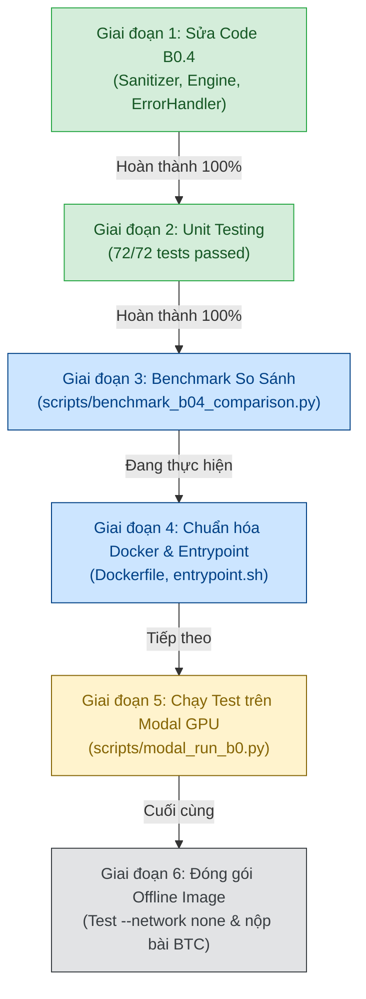

# QUY TRÌNH NÂNG CẤP TẦNG THỰC THI (B0.4) & TRIỂN KHAI ĐÓNG GÓI DOCKER / MODAL.AI
**Dự án:** DataMate — Zalo AI Challenge 2026 (Track 2)  
**Nhóm:** UIT Last Dance  
**Nhánh:** `feature/b1-4-executor_minh`  
**Tài liệu liên quan:** [`improvement_execute_layer_plan.md`](./improvement_execute_layer_plan.md), [`USER_TESTING_GUIDE.md`](./USER_TESTING_GUIDE.md)

---

## I. TỔNG QUAN TIẾN ĐỘ THỰC HIỆN



---

## II. CHI TIẾT CÁC BƯỚC TRONG QUY TRÌNH

### Bước 1: Hoàn thiện Code Core & Unit Tests Module B0.4 (Đã Xong)
* **Mục tiêu:** Khắc phục triệt để 6 điểm nghẽn của tầng thực thi trong môi trường sandbox Docker và hỗ trợ tối đa cho One Bounded Retry.
* **File đã cập nhật:**
  - `src/datamate/b0/b04/sanitizer.py`: Parse AST bằng `sqlglot` trước, không quét regex thô tránh chặn nhầm literal (`WHERE status = 'update'`), chặn hàm hệ thống `duckdb_*`, bóc tách khối markdown cuối cùng và xóa comment sau `;`.
  - `src/datamate/b0/b04/engine.py`: Tự động tạo và cấu hình thư mục spill `/tmp/duckdb_spill`, thiết lập RAM (`B04_DUCKDB_MAX_MEMORY`), threads (`B04_DUCKDB_THREADS`); cache thư mục dữ liệu thô vào `/tmp`; kiểm tra kết quả toàn `NULL` để kích hoạt `EmptyResultWarning`.
  - `src/datamate/b0/b04/error_handler.py`: Bổ sung hàm `enrich_error_with_schema()` truy vấn danh sách bảng/cột thực tế đính kèm vào thông báo lỗi khi gặp `BinderError` / `CatalogError`.
  - `tests/test_b0_4_executor.py`: Bổ sung 4 test case chuyên sâu (`test_15` -> `test_18`).
* **Kết quả:** 72/72 tests pass toàn bộ trên nhánh `feature/b1-4-executor_minh`.

---

### Bước 2: So Sánh Đối Đầu Trước & Sau Cải Tiến (Benchmark Comparison) (Đang Thực Hiện)
* **Mục tiêu:** Chứng minh định lượng tính ưu việt của phiên bản mới so với bản cũ.
* **File thực thi:** [`scripts/benchmark_b04_comparison.py`](../../../scripts/benchmark_b04_comparison.py)
* **Nội dung so sánh:**
  1. *Lọc chuỗi có từ khóa cấm:* Câu lệnh `WHERE trang_thai = 'update'` trước đây bị chặn nhầm bởi `SecurityViolation` -> Nay thực thi trơn tru và trả kết quả chính xác.
  2. *Trích xuất Markdown đa khối:* Khi LLM sinh 2 khối code (khối 1 nháp, khối 2 chốt) -> Bản mới bóc tách đúng khối cuối cùng và xử lý sạch comment ở đuôi.
  3. *Hỗ trợ Bounded Retry:* Lỗi sai cột/bảng trước đây chỉ báo lỗi cụt ngủn -> Bản mới tự động đính kèm `[Gợi ý Schema thực tế trong DB]:` chứa bảng và cột thực tế.
  4. *Result Validation:* Hàm `SUM`/`AVG` trả về 1 dòng `NULL` do lệch filter từ khóa -> Bản mới chủ động chuyển thành `route="recoverable"` kèm `EmptyResultWarning` để LLM sửa lại mệnh đề `WHERE`.
  5. *Hiệu năng:* Đọc thư mục dữ liệu qua bộ nhớ đệm `.duckdb` trong `/tmp` giúp các câu hỏi sau không phải nạp lại CSV/Excel từ đĩa.

---

### Bước 3: Chuẩn Hóa Đóng Gói Docker Image (Đang Thực Hiện)
* **Mục tiêu:** Tạo Docker Image độc lập, đáp ứng đầy đủ yêu cầu của Ban tổ chức Zalo AI Challenge 2026.
* **File đã tạo/cập nhật:**
  - [`Dockerfile`](../../../Dockerfile): Base PyTorch/CUDA, cài đầy đủ `duckdb`, `sqlglot`, `pydantic`, `pandas`, `pyarrow`, tạo thư mục `/tmp/duckdb_spill` quyền 777.
  - [`entrypoint.sh`](../../../entrypoint.sh): Nhận `--input_dir` và `--output_dir` (tương thích cả cú pháp `--input-dir`), tự động chạy pipeline và ghi kết quả ra `submission.jsonl`.
* **Quy chuẩn kiểm tra:**
  - Chạy thử container với cờ ngắt mạng `--network none` và thư mục đầu vào chỉ đọc `:ro`.

---

### Bước 4: Chạy Thử Nghiệm Trên Nền Tảng Modal.ai GPU (Kế Tiếp)
* **Mục tiêu:** Sử dụng GPU (A100 / A10G / L4) của Modal để kiểm thử tích hợp model Qwen + vLLM + B0.4 + B0.5.
* **File thực thi:** [`scripts/modal_run_b0.py`](../../../scripts/modal_run_b0.py)
* **Lợi ích:**
  - Tự động download và cache weights của model `Qwen/Qwen3.5-9B` trên Modal Volume (`datamate-b0-volume`).
  - Cho phép chạy thử từng doanh nghiệp cụ thể (ví dụ `--business-id biz_105`) hoặc giới hạn câu hỏi (`--limit 10`) để tiết kiệm thời gian và chi phí.
  - Tự động tải file `submission.jsonl`, `detailed_logs.jsonl` và `eval_report.json` về máy cục bộ.

---

### Bước 5: Build Final Image & Xuất File Nộp Bài (Hoàn Tất)
* **Mục tiêu:** Xuất file nén `.tar.gz` để nộp cho BTC hoặc push lên Container Registry do BTC chỉ định.
* **Lệnh thực hiện:**
  ```bash
  docker build -t uit_last_dance_b0:v1.0 .
  docker save uit_last_dance_b0:v1.0 | gzip > uit_last_dance_b0_v1.0.tar.gz
  ```
