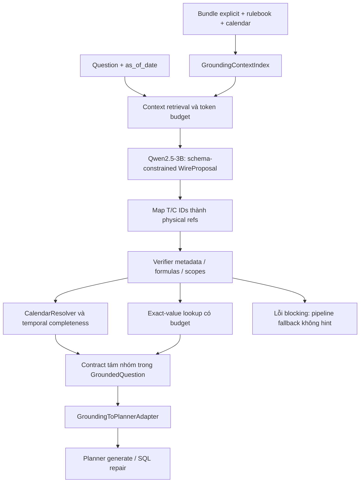

# Báo cáo grounding hiện tại — Qwen2.5 + code verification

**Ngày cập nhật:** 2026-11-16.  
**Phiên bản prompt hiện tại:** `neo-temporal-v4`.  
**Lượt inference mới nhất được review:** `neo_smoke3_20261116_025905_573731`.

## 1. Kết luận về trạng thái hiện tại

Grounding mới đã có đường chạy thực tế bằng Qwen2.5-3B-Instruct trên Modal, consume bundle enriched có sẵn và trả contract tám nhóm cho Planner. Constrained decoding đã giải quyết lỗi JSON không hợp lệ và hiện tượng sinh danh sách measure lặp dài trong các lượt đầu. Code đã có kiểm tham chiếu, phép tính, scope, cấu trúc cohort/JOIN, tra giá trị có giới hạn và resolver thời gian, bao gồm lịch âm.

**Chưa hoàn thành toàn bộ acceptance criteria của [upgrade_grounding.md](upgrade_grounding.md).** Kiểm chứng hiện tại chủ yếu gồm test CPU, preflight bundle và bốn lượt smoke trên cùng ba câu. Chưa có bằng chứng accuracy đầu cuối, cải thiện so với Planner không grounding, benchmark 1.000 câu hoặc chất lượng nhận diện lịch âm của Qwen trên GPU.

Lượt v4 mới nhất cho kết quả:

- **3/3 response hợp lệ về JSON/schema wire**, một Qwen call/câu, kết thúc bằng `stop`.
- **2/3 tạo được contract `partial`**, một câu bị verifier chặn.
- **Một câu có temporal plan đúng và đủ hai kỳ MTD**; một câu khai đúng quan hệ so năm trước nhưng thiếu thành phần tháng/năm; câu còn lại sai cohort/JOIN/thời gian.
- Lỗi thiếu kỳ hiện được ghi rõ trong `assessment.unresolved` và `temporal_plan.completeness_status`, thay vì âm thầm trả một window như trước.

Có thể dùng để **kiểm thử tích hợp pipeline**. Chưa nên coi mọi claim trong contract là ràng buộc đã xác minh đúng nghiệp vụ.

## 2. Phạm vi và nguồn dữ liệu

### 2.1. Input

- Enriched bundle public test: `synthetic_data/output_b01_b02/artifacts_public_Test/enriched_bundles_public_test/<business>/<fingerprint>/`.
- Chọn bundle bằng manifest explicit; không tự lấy fingerprint bất kỳ.
- Đọc `business_context.json`, `source_manifest.json` nếu có và `data.duckdb`.
- Rulebook: `data/test/public_test/rulebook.md`.
- Calendar: `data/test/public_test/calendar.csv`.
- Bộ smoke: ba câu nguyên văn từ `synthetic_data/grounding_simulated_public_test_50/questions.jsonl`.

Bundle nguồn là read-only. Runner mới không chạy ingestion, normalization, semantic discovery hoặc ghi lại semantic catalog. Runtime tạo bản context riêng có global policies/calendar để truyền Planner, kể cả fallback không hint.

### 2.2. Những gì đã kiểm chứng

Preflight đã đọc đủ **14 business và đối chiếu 903 cột** khai báo với schema vật lý DuckDB. Calendar có **1.461 ngày dương liên tục từ 2024-01-01 đến 2027-12-31**, kèm ngày/tháng/năm âm và cờ tháng nhuận.

Các kiểm tra này chứng minh tính đọc được và tham chiếu vật lý, không chứng minh mọi giá trị chuẩn hóa hoặc binding nghiệp vụ đúng. Tra calendar chứng minh mapping khớp file được cung cấp, không phải kiểm chứng thiên văn độc lập.

## 3. Kiến trúc đang chạy



### 3.1. Nạp context và retrieval

`GroundingContextIndex` giữ full metadata của bundle, policies có nguồn, mapping bảng/cột và unit candidates. Schema preflight dùng DuckDB read-only. Fingerprint hiện gồm context, rulebook/calendar hashes, manifest và DB stat identity (size/mtime); không hash toàn bộ DB mỗi request. Cache giả định source immutable.

Prompt có directory nguồn, schema cards, core policies, README evidence được retrieval xếp hạng, metric/unit/JOIN candidates. Matching hiện là lexical bỏ dấu; chưa có embedding/reranker. Schema cards giữ tên cột nguồn/provenance để model phân biệt vai trò.

Khi quá budget, code bỏ JOIN statistics và evidence phụ trước; giữ ít nhất hai README policy rows được xếp cao nếu có và ít nhất một schema card. Nếu phần bắt buộc vẫn không vừa thì fail trước gọi model. **Chưa có bảo đảm retrieval chọn đúng mọi evidence quan trọng:** từng thấy rule quy đổi sản phẩm hoặc giao hàng chiếm chỗ trong câu doanh thu/khách hàng.

### 3.2. Qwen proposal và constrained decoding

Qwen trả **WireProposal**, không trả trực tiếp contract đầy đủ cho Planner:

- `T*`: ID bảng; `C*`: ID cột; `M1..M8`: ID measure.
- ID bảng/cột map theo index và được chuyển lại thành physical refs bằng code.
- Mapping chỉ thay các reference fields; không thay literal, raw expression hoặc policy text.
- Sampler dùng JSON Schema với `StructuredOutputsParams(json=...)`, enum refs theo schema cards thực sự được gửi, field allowlist và list bounds.
- Tối đa **8 measures và 8 time specs** trong wire proposal.
- Không đưa nguyên khối JSON Schema nhiều `$defs` vào phần ngôn ngữ của prompt.
- Prompt có bốn ví dụ hư cấu, độc lập với question IDs/baseline smoke: so năm trước, cohort, ngày âm và MTD matched-days.

`QwenStructuredBackend` giữ một instance vLLM, dùng lại giữa các câu. Không tương thích structured-output API là lỗi startup; không âm thầm đổi sang text decoding. Schema đúng chưa bảo đảm đúng binding, ngày được hiểu đúng hoặc công thức đúng.

### 3.3. Code verification

Đã kiểm được:

- Business identity, bảng/cột tồn tại; refs resolve được.
- Aggregate/operator enums, số operands, cycle trong đồ thị measure; kiểu numeric cho sum/avg.
- Cây predicate AND/OR/NOT, refs và scope filter.
- JOIN sources/key ownership; UNION ALL yêu cầu compatible named columns/types.
- Cohort grouping khớp grain và tham chiếu đúng measure.
- Unit factor Decimal dương hữu hạn, target/unit refs; chặn áp factor lên cột already-converted.
- Cột ngày có kiểu DATE/TIMESTAMP và temporal scopes hợp lệ.

Chưa chứng minh được tự động:

- Khóa có thật sự là khóa đơn/khách đúng scope hay không.
- Metric đúng nghiệp vụ; grain khớp chưa chứng minh aggregate đếm đúng thực thể.
- JOIN cardinality/fanout và tính đúng ngữ nghĩa của quan hệ.
- Scope sản phẩm đủ để áp hệ số quy đổi.
- Tất cả điều kiện từ câu hỏi/rulebook đã được chuyển thành filter/calculation.

Exact-value provider dùng SQL parameterized, identifier allowlist, connection read-only riêng mỗi lần verify. Tối đa hai query, khoảng 100ms/query và budget query khoảng 200ms/request; có Timer interrupt và cleanup. Đây không phải hard wall-time SLA cho toàn grounding/connection startup. Tối đa năm giá trị lookup được nhận; cache LRU 4.096 entries/provider. Timeout hoặc lookup không thấy giá trị không trở thành proof không thể trả lời.

## 4. Contract Planner hiện tại

Tám nhóm cấp cao vẫn là Planner contract `2.0`, độc lập bundle contract `1.1`:

| Nhóm | Nội dung đang truyền | Giới hạn hiện tại |
|---|---|---|
| `request` | Question/business identity, câu hỏi gốc, as-of, version | Không tự lấy ngày máy chạy thay as-of |
| `intent` | Operation, answer type, order/limit, tie-break | Model có thể chọn đúng enum nhưng hiểu sai ý hỏi |
| `source_plan` | Physical sources/columns, JOIN/UNION combinations | Chưa tự routing family hoàn chỉnh hoặc chứng minh JOIN đúng |
| `semantic_plan` | Measures, dimensions, filter tree, grain, entity keys, units, cohort | Binding và công thức giữ semantic_unreviewed; policy filters còn thiếu trong smoke |
| `temporal_plan` | Intent thời gian, completeness status, constraints đã materialize | Complete chỉ theo intent/spec đã khai báo, không phải xác minh hiểu đúng câu gốc |
| `value_bindings` | Exact values quan sát được trong DB và phương pháp lookup | Chưa fuzzy alias disambiguation hoàn chỉnh |
| `policies` | Nội dung, source/hash, refs; code giữ core policies dù model bỏ policy_refs | Có policy text chưa đồng nghĩa đã có predicate thực thi |
| `assessment` | Partial/unknown, warnings, unresolved, missing proof | Chưa có bộ semantic attestation để tự nâng toàn payload thành verified |

`GroundedQuestion.planner_input` chứa payload chuẩn. `GroundingToPlannerAdapter` render cùng payload cho Planner; không duy trì một bộ tính ngày riêng trong formatter. Hint hiện truyền JSON đầy đủ, **chưa thực thi mục tiêu 1.024 token** của plan.

## 5. Temporal mới nhất: neo-temporal-v4

### 5.1. Model phải quyết định rõ điều gì?

WireProposal bắt buộc có:

- `temporal_intent`: `none`, `single_period`, `compare_periods`, `compare_measures`, `unknown`.
- `time`: danh sách; không được bỏ field này.

Mỗi WireTimeSpec bắt buộc có `raw_expression`, `kind`, `column`, `applies_to` và:

| Field | Ý nghĩa |
|---|---|
| `period_extent` | `full_period`, `to_as_of`, `snapshot`, `unknown` |
| `comparison` | `none`, `previous_year`, `previous_month_matched`, `previous_equal_days`, `unknown` |
| `role` | `primary`, `comparison`, `series` |

Trong wire, `comparison=none` được code map thành null cho API calculator. `unknown` được giữ unresolved, không dùng ngày/quan hệ model đoán.

**Một time spec có relation hợp lệ là đủ để code tạo hai constraints.** Ví dụ month=2/year=2026, full_period, comparison=previous_year sinh:

- `T0_0`, label primary: `[2026-02-01, 2026-03-01)`.
- `T0_1`, label comparison: `[2025-02-01, 2025-03-01)`.

Hai kỳ explicit có thể là hai specs với role primary/comparison, comparison=none trên từng spec. Không bắt Qwen tự tính ngày dương hay lặp measure cho mỗi kỳ.

### 5.2. Phân giải và completeness

- Explicit month lấy cả tháng; `to_as_of` cắt đến hết anchor và kiểm anchor nằm trong kỳ.
- MTD matched-days dùng cùng số ngày, clamp cuối tháng trước.
- Snapshot giữ lịch sử/cutoff riêng, không thêm event window tháng mặc định.
- Events dùng `[start_inclusive, end_exclusive)`.
- Code không tự đổi timezone khi nguồn chưa khai báo.

`temporal_validation.py` đối chiếu intent với windows:

- Period comparison cần primary/comparison trong cùng column, date role và applies_to.
- Cho phép hai scopes riêng nếu được nối rõ bằng derived measure operands.
- Compare hai measures trong cùng một kỳ có thể không cần hai windows, nhưng phải có hai operands khác ID bind rõ.
- Thiếu kỳ ghi `MISSING_COMPARISON_WINDOW`; thiếu toàn window ghi `MISSING_TEMPORAL_WINDOW`; có conflict/unknown ghi lỗi riêng.
- Khi còn primary hợp lệ, giữ nó cùng source/measure hữu ích; không fail toàn proposal vì chỉ thiếu comparison.

Temporal constraint hiện dùng `verification_status=reference_valid`, `calculation_status=calculated`, `semantic_status=semantic_unreviewed`. **Tính đúng phép toán ngày từ spec không chứng minh spec đúng với câu hỏi.**

### 5.3. Thiếu sót còn lại ở schema temporal

Required extent/relation/role chưa đủ để bảo đảm đủ thành phần ngày. `year`, `month`, `quarter` vẫn optional, chưa có schema theo nhánh `kind` để buộc thành phần cần thiết. Model có thể chọn month nhưng bỏ month, hoặc quarter nhưng bỏ quarter. Lượt mới nhất đã gặp cả hai dạng.

Calculator chưa có lớp kiểm missing components đủ rõ trước `date()`, nên lỗi có thể hiện dưới dạng TypeError như `'NoneType' object cannot be interpreted as an integer`, rồi được chuyển thành TEMPORAL_UNRESOLVED. Không tự parse lại raw_expression để bù giá trị.

Completeness hiện chỉ kiểm được những yêu cầu thể hiện trong operation/temporal_intent/spec. Nếu model hiểu sai cả intent và spec theo cùng một hướng, code không có bộ hiểu ngôn ngữ thứ hai để phát hiện chắc chắn.

## 6. Lịch âm

CalendarResolver dùng bảng tra được cung cấp, gồm lunar_day/month/year/leap; kiểm duplicate mapping và coverage ngày dương liên tục. Có các khả năng:

- Ngày âm cụ thể, tháng/năm âm khi đủ coverage.
- Tết năm Y: 23 tháng Chạp Y−1 đến hết mùng 10 tháng Giêng Y.
- Khoảng âm với hai endpoints explicit.
- Ngày âm lặp trong phạm vi ngày dương giới hạn, giữ tập ranges OR thay vì phủ min/max.
- Phát hiện tháng thường/tháng nhuận mơ hồ, ngày thiếu và kỳ bị cắt ở rìa calendar.
- Tra năm âm của as-of cho biểu thức tương đối.

Các fixture đã test: rằm tháng Giêng 2026 tương ứng `[2026-03-03, 2026-03-04)`; Tết 2026 là `[2026-02-10, 2026-02-27)` và kỳ trước cùng độ dài `[2026-01-24, 2026-02-10)`.

Lunar matched-month/YTD comparison chưa có policy đầy đủ sẽ unresolved. Không tự clamp ngày âm không tồn tại hoặc chọn tháng nhuận khi có nhiều ứng viên.

**Đã kiểm calculator bằng test CPU; chưa có câu âm lịch trong bộ ba smoke**, nên chưa kết luận Qwen nhận diện đúng intent âm lịch qua inference thực tế.

## 7. Partial, failed và tích hợp pipeline

- `partial`: tạo được contract có thông tin hữu ích nhưng còn thiếu/chưa xác minh. Đây là trạng thái mặc định của engine hiện tại; không đo quality bằng tỷ lệ partial.
- `failed`: có lỗi blocking ở parse/materialization/verification/runtime, không tạo được contract dùng được. JSON đúng vẫn có thể failed vì refs/scope/cohort/JOIN sai.
- `temporal_plan.completeness_status=complete`: đủ theo các kiểm tra temporal đang áp dụng; không đồng nghĩa toàn contract verified.
- Không tạo proof unsupported chỉ vì model, retrieval hoặc lookup thất bại.

Pipeline đã có adapter nhận payload v2. Khi grounding exception, pipeline chạy Planner không hint với runtime context; khi partial, Planner nhận payload, policies, warnings và câu hỏi gốc. Local runner có thể bật end-to-end bằng `--planner-config`.

**Chưa có salvage tổng quát theo từng claim/nhóm:** temporal errors phần lớn được giữ partial, nhưng lỗi JOIN/cohort/reference khác vẫn có thể làm fail toàn proposal, mất cơ hội dùng nguồn/measure đúng. Tám nhóm có phụ thuộc; giữ một nhóm không có nghĩa có thể dùng độc lập mọi field của nó.

Ngay cả partial có format hợp lệ vẫn có thể chứa hint dẫn sai SQL. Không nên lấy mọi constraint làm hard rule khi semantic status chưa xác minh. Planner hiện vẫn phải tự bổ sung đáng kể policy filters và binding còn thiếu.

## 8. Bằng chứng inference Modal

### 8.1. Bộ ba câu cố định

| Question ID | Business | Câu hỏi |
|---|---|---|
| q_8728cb609428 | dev_001 | 2/26 so với cùng kỳ năm trước, doanh thu lên hay xuống bao nhiêu % vậy? |
| q_5f2d481dc5d4 | dev_003 | Từ đầu tháng này đến hết hôm nay, doanh thu thay đổi bao nhiêu % so với cùng kỳ tháng trước? |
| q_621a456cc773 | dev_004 | T1/2026 khách mua từ 2 đơn trở lên là mấy người z? |

Baseline trong `grounding_simulated_public_test_50/grounding.jsonl` là assistant-simulated contract, **không phải gold answer**. Chỉ dùng đối chiếu sau inference, không đưa baseline vào prompt/binding.

### 8.2. Tiến triển qua bốn lượt

| Run UTC trong tên thư mục | Phiên bản/thay đổi | Kết quả quan sát |
|---|---|---|
| [013030_020903](../../artifacts/runs/neo_smoke3_20261116_013030_020903/results.jsonl) | Proposal ban đầu, output 768 | Cả 3 fail; EOF/invalid JSON, một prompt mất hết schema, bare column ref |
| [013735_578557](../../artifacts/runs/neo_smoke3_20261116_013735_578557/results.jsonl) | Output 2048, sửa trimming/debug | Cả 3 fail; một response thừa dấu đóng/schema sai, hai response lặp tới hết token |
| [022028_035209](../../artifacts/runs/neo_smoke3_20261116_022028_035209/results.jsonl) | neo-compact-v3, constrained decoding | 3 JSON hợp lệ; 2 partial, 1 fail; cả hai câu comparison thiếu t1; MTD lấy cả tháng |
| [025905_573731](../../artifacts/runs/neo_smoke3_20261116_025905_573731/results.jsonl) | neo-temporal-v4 | 3 JSON hợp lệ; 2 partial, 1 fail; MTD đúng cặp; câu so năm trước báo missing components/windows |

Không dùng cùng ba câu được chỉnh prompt qua nhiều vòng làm bằng chứng cải thiện tổng quát. Cần paraphrase/holdout độc lập.

### 8.3. Review chi tiết lượt mới nhất

| Câu | Phần có ích | Thiếu/sai | Kết luận |
|---|---|---|---|
| q_8728cb609428 | Đúng sổ bán, SUM(thanh_tien), cột ngày; compare_periods/previous_year | Bỏ year/month; month=None làm calculator lỗi; constraints rỗng | Partial, temporal incomplete; validator phát hiện tốt hơn v3 nhưng chưa có t0/t1 |
| q_5f2d481dc5d4 | Đúng sổ bán, thanh_tien_d, order_date, relative=this, to_as_of, previous_month_matched | Filter loại đơn hủy/trả và entity keys còn rỗng | Temporal đúng; toàn grounding vẫn partial |
| q_621a456cc773 | Chọn đúng sổ bán, có shape cohort >=2/count_groups | JOIN T4 chưa khai trong sources; key pair ma_don → gia_cu sai; đếm tên khách thay mã đơn; chọn quarter cho T1/2026 | Verifier chặn, failed; không sửa bằng tự thêm source |

Cặp MTD thực tế đã sinh đúng:

```text
primary:    [2025-12-01, 2025-12-10)
comparison: [2025-11-01, 2025-11-10)
```

Token output và elapsed từng câu: **168 / 3.708s**, **173 / 2.129s**, **293 / 2.790s**. Các số này là per-question diagnostics của một smoke run, không phải warm p50/p95 và không bao gồm toàn bộ thời gian build image, download/load model. Chưa đạt điều kiện kết luận SLA từ mẫu ba câu.

Review đầy đủ: [evaluation.md](../../artifacts/runs/neo_smoke3_20261116_025905_573731/evaluation.md).

## 9. Kiểm thử và acceptance còn thiếu

Lệnh kiểm liên quan đã chạy thành công ở lần sửa v4:

```bash
uv run pytest tests/grounding tests/test_neo_smoke_setup.py \
  tests/test_grounded_planner_bridge.py tests/test_datamate_pipeline.py \
  tests/test_voting.py -q
```

**148 tests passed.** Bao gồm wire schema/alias mapping/literal preservation, backend schema vào sampler với fake model, one-call, invalid JSON/ref/cycle, temporal required fields/completeness/scope, MTD/YTD/năm nhuận/Tết và pipeline/bridge rollback.

Đây không phải tuyên bố toàn test suite đều pass. Một test ngoài tập lệnh trên, `test_qwen_toml_config_loads_thinking_budget`, từng fail vì kỳ vọng enable_thinking=True trong khi cấu hình Planner tại HEAD là False; không phải kết quả đánh giá grounding v4.

Các mục của plan chưa hoàn thành hoặc chưa được chứng minh:

- Semantic attestation metric/grain/key/JOIN; kiểm fanout/coverage chọn lọc.
- Family routing tự động theo window, source partitions và min/max evidence.
- Policy → filter binding đủ, nhất là loại cả đơn trả/hủy, khách lẻ và mẫu số cohort.
- Fuzzy/alias disambiguation, unit product-scope proof.
- Salvage theo claim/nhóm ngoài temporal.
- Exact proposal cache, chat_batch và benchmark throughput.
- Hint budget 1.024 token có bảo toàn semantics.
- Accuracy đầu cuối, false-unanswerable, holdout, so bốn mode trên cùng context.
- GPU coexistence/OOM với Planner, cold/warm latency có phân tách.
- Inference lunar questions, không chỉ calculator tests.

## 10. Cấu hình và cách chạy hiện tại

Config: [qwen2_5_3b_neo_grounding.toml](../../configs/qwen2_5_3b_neo_grounding.toml).

| Tham số | Giá trị hiện tại |
|---|---|
| Model | Qwen/Qwen2.5-3B-Instruct |
| Backend | Offline vLLM, structured JSON output |
| Dtype | bfloat16 |
| Context model | 8192 tokens |
| Input ceiling của engine | 5632 tokens, còn kiểm budget theo config/tokenizer |
| Output ceiling | 2048 tokens |
| Sampling | temperature=0, top_p=1, top_k=-1 |
| Model calls | 1/request qua prompt budget; không LLM repair |
| max_num_seqs | 8; runner hiện vẫn gọi grounding tuần tự |
| GPU memory utilization | 0.22; không phải chứng cứ hai model đã chạy đồng thời ổn |

Tạo/reproduce input staging:

```bash
uv run python scripts/prepare_neo_smoke.py
```

Preflight trước, không gọi GPU:

```bash
uv run modal run scripts/modal_run_neo_grounding.py --preflight
```

Inference ba câu và lưu debug:

```bash
uv run modal run scripts/modal_run_neo_grounding.py --debug-model-output
```

Script tự tạo run name/output mới, preflight local, mount ba bundle, tải/cache model trên volume `datamate-b0-volume`, gọi A100 rồi tải kết quả và comparison về `artifacts/runs/<run_name>/`. Modal smoke hiện chỉ chạy grounding, không chạy Planner. End-to-end có đường local runner nhận `--planner-config`; cần kiểm thử riêng.

Output gồm `results.jsonl`, `preflight.json`, `run_config.json`, `comparison.md`, `comparison.json`. Debug thêm prompt thực tế, schema decode, reference map và raw response trong diagnostics. Mặc định không lưu các nội dung debug này. Kiểm `prompt_version=neo-temporal-v4` và `constrained_decoding=true` để nhận diện đường chạy mới.

## 11. Thứ tự cải thiện đề xuất

1. **Temporal components theo kind:** discriminated/conditional schema cho tháng/quý/ngày/range/relative; validate missing components trước arithmetic, trả lỗi rõ thay NoneType. Không bù ngày bằng suy đoán hoặc hardcode smoke IDs.
2. **Cohort và source consistency:** phân biệt khóa được đếm với khóa grouping; kiểm combination đúng nguồn/side/key, tránh JOIN không cần thiết; chỉ grain khớp chưa đủ.
3. **Salvage và trust theo claim:** giữ nguồn/measure đúng khi JOIN hoặc temporal sai; đánh dấu dependency bị ảnh hưởng để Planner không áp dụng nhầm.
4. **Policy/filter và retrieval:** binding rule bắt buộc; ưu tiên evidence về date/grain/identity hơn quy đổi/nguồn không liên quan.
5. **Mở rộng evaluation:** thêm lunar/paraphrase/holdout; sau đó chạy Planner end-to-end để đo lợi ích/thiệt hại của partial hints so với không grounding.

Không coi việc JSON parse thành công hoặc có đủ tám nhóm là đã đạt chất lượng grounding. Chỉ nâng trust khi có phép kiểm và bằng chứng tương ứng.

## 12. Bản đồ code và tài liệu

| File | Vai trò |
|---|---|
| [context_index.py](../../src/datamate/grounding/context_index.py) | Consume bundle, preflight schema, policy/index, runtime context |
| [neo_prompt.py](../../src/datamate/grounding/neo_prompt.py) | Prompt v4 và ví dụ độc lập |
| [compact_proposal.py](../../src/datamate/grounding/compact_proposal.py) | Wire schema, constrained refs và map ID |
| [neo_contracts.py](../../src/datamate/grounding/neo_contracts.py) | Internal Proposal, measures, filters, cohorts, unit plan |
| [neo_backend.py](../../src/datamate/grounding/neo_backend.py) | Một Qwen instance, token counting, structured generation |
| [neo_engine.py](../../src/datamate/grounding/neo_engine.py) | Budget, proposal, materialization, verifier và GroundedQuestion |
| [neo_verifier.py](../../src/datamate/grounding/neo_verifier.py) | Verification và dựng tám nhóm Planner |
| [calendar_resolver.py](../../src/datamate/grounding/calendar_resolver.py) | Gregorian/lunar calculator |
| [temporal_validation.py](../../src/datamate/grounding/temporal_validation.py) | Kiểm intent/completeness/cặp scopes |
| [value_verifier.py](../../src/datamate/grounding/value_verifier.py) | Exact-value DB verification có budget/cache |
| [runtime.py](../../src/datamate/grounding/runtime.py), [contracts.py](../../src/datamate/grounding/contracts.py), [adapters.py](../../src/datamate/grounding/adapters.py) | Boundary, legacy-compatible object và Planner bridge |
| [types.py](../../src/datamate/planner/types.py), [vllm_model.py](../../src/datamate/planner/vllm_model.py) | GenerationOptions.json_schema → StructuredOutputsParams |
| [prepare_neo_smoke.py](../../scripts/prepare_neo_smoke.py) | Chọn/copy ba câu và baseline so sánh |
| [run_neo_grounding.py](../../scripts/run_neo_grounding.py) | Prebuilt local runner; llm_verified/rules/hybrid/off |
| [modal_run_neo_grounding.py](../../scripts/modal_run_neo_grounding.py) | Modal smoke, model cache, download outputs |

Tài liệu implementation chi tiết nằm tại [overall_neo_grounding.md](../code/grounding_upgrade/overall_neo_grounding.md) và các file cùng tên module trong [docs/code/grounding_upgrade](../code/grounding_upgrade/).

Báo cáo này mô tả code và bằng chứng thực tế tại thời điểm cập nhật; các mục đề xuất ở §11 **chưa được triển khai chỉ bởi việc ghi báo cáo này**.
